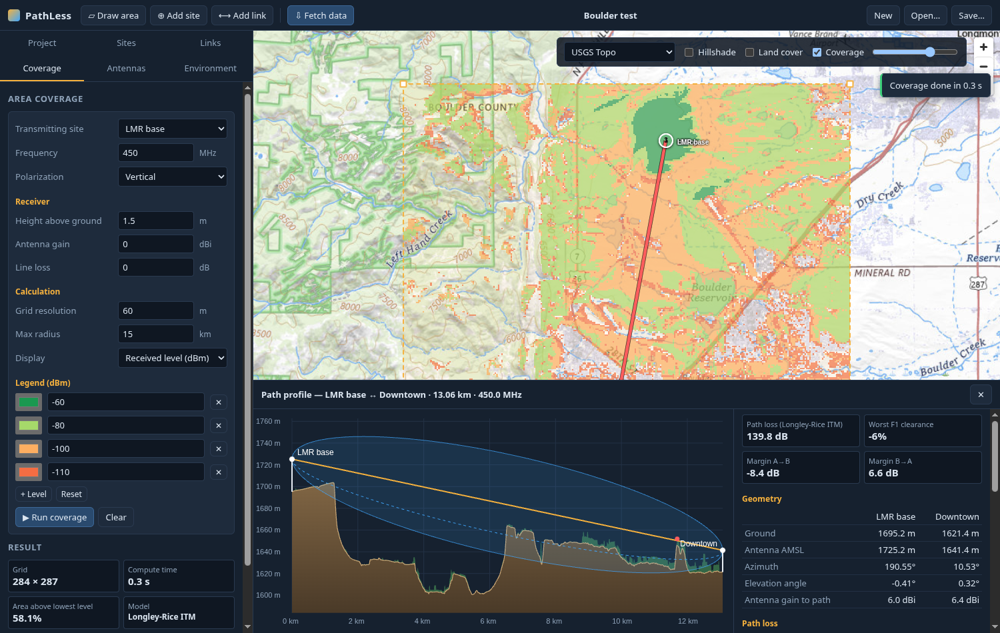

<h1 align="center">
  <picture>
    <source media="(prefers-color-scheme: dark)" srcset="docs/brand/pathless-logo-dark.svg">
    
  </picture>
</h1>

<p align="center">
  <a href="https://github.com/n9tax/PathLess/actions/workflows/ci.yml"></a>
  <a href="https://github.com/n9tax/PathLess/releases"></a>
</p>

RF path and coverage analysis for Linux that finds its own data. Draw a
polygon on the map and PathLess works out which USGS 3DEP elevation and NLCD
land-cover data you need, downloads it, caches it, and runs point-to-point
link and area coverage analysis on top. No hunting for tiles.

Covers VHF/UHF (LMR, broadcast), unlicensed / WISP, cellular / CBRS and
licensed microwave backhaul.



## Features

- **Automatic data**: polygon → tile plan (with download size) → download →
  mosaic. USGS 3DEP elevation from 1 arc-second (~30 m) down to 1 m lidar, and
  NLCD land cover for clutter, fetched straight from the USGS / MRLC web
  services and cached under `~/.cache/pathless`.
- **Point-to-point links**: earth-curvature path profile with clutter, first
  Fresnel zone and clearance; Longley-Rice (ITM) loss; free space + ITU-R
  P.526 delta-Bullington diffraction; P.676 gaseous absorption; two-way link
  budget and field strength; ITU-R P.530 multipath and rain (P.838 / P.837)
  availability for microwave.
- **Area coverage**: per-cell terrain profiles from a site, ITM or microwave
  model, 3-D antenna pattern gain (azimuth and mechanical tilt), NLCD clutter
  heights along the path and ITU-R P.2108 terminal clutter loss. Shown as
  received level, field strength or path loss with an editable legend.
- **Antennas**: 93 built-in generic omnis, sectors, panels, yagis and dishes
  from VHF to 86 GHz (patterns from ITU-R F.1336 / F.699 / F.1245), plus
  MSI / Planet pattern file import for vendor antennas.
- **Projects**: save and open projects as JSON; the current project autosaves.

## Install

Download the latest installer from the
[Releases page](https://github.com/n9tax/PathLess/releases):

| Distribution | File | Install |
|---|---|---|
| Debian, Ubuntu, Mint, Pop!_OS | `pathless_<version>_amd64.deb` | `sudo apt install ./pathless_<version>_amd64.deb` |
| Fedora, RHEL, openSUSE | `pathless-<version>-1.x86_64.rpm` | `sudo dnf install ./pathless-<version>-1.x86_64.rpm` |
| Arch, CachyOS, Manjaro | `packaging/arch/PKGBUILD` | `cd packaging/arch && makepkg -si` |
| Anything else | `pathless_<version>_amd64.AppImage` | `chmod +x pathless_*.AppImage && ./pathless_*.AppImage` |

PathLess needs an internet connection to download terrain and clutter the
first time an area is used; after that the cached data works offline.

## Quick start

1. **Draw area**: click the corners of your study area, double-click to finish.
2. **Fetch data**: check what's needed (tile count and size), then download.
3. **Add site**: click the map; set the antenna, height, azimuth, power and losses.
4. **Add link** between two sites to get the path profile and link budget, or
   open **Coverage** to map a site's coverage over the study area.
5. **Environment** holds climate, ground constants, reliability percentages
   and the clutter height used for each land-cover class.

## Building from source

Requirements: Rust (stable) and the WebKitGTK 4.1 stack Tauri uses.

```sh
# Arch / CachyOS
sudo pacman -S --needed webkit2gtk-4.1 base-devel
# Debian / Ubuntu
sudo apt install libwebkit2gtk-4.1-dev libsoup-3.0-dev librsvg2-dev build-essential
# Fedora
sudo dnf install webkit2gtk4.1-devel libsoup3-devel librsvg2-devel
```

```sh
cargo run -p pathless --release            # run the app
cargo test --workspace                     # unit + reference-vector tests
cargo test -p pathless-data -- --ignored   # live download tests (network)
```

To build the `.deb`, `.rpm` and AppImage installers:

```sh
cargo install tauri-cli --version "^2" --locked
cd app/src-tauri && cargo tauri build
# output: target/release/bundle/{deb,rpm,appimage}/
```

If `cargo install tauri-cli` fails with rustc crashing (`SIGSEGV`, "you can
increase rustc's stack size") while compiling the `rpm` crate, retry with a
bigger compiler stack:
`RUST_MIN_STACK=33554432 cargo install tauri-cli --version "^2" --locked`.

Installers built on a rolling-release distribution link against its newer
glibc and won't install on older systems; release builds are made on
Ubuntu 22.04 by the [release workflow](.github/workflows/release.yml), which
runs when a `v*` tag is pushed.

## Project layout

| Path | What |
|---|---|
| `crates/pathless-itm` | Pure-Rust port of the NTIA/ITS Irregular Terrain Model (Longley-Rice) |
| `crates/pathless-rf` | ITU-R models, diffraction, link budget, antenna patterns and catalog |
| `crates/pathless-data` | Data sources (3DEP, NLCD), tile planning, cache, GeoTIFF decode, profiles |
| `crates/pathless-engine` | Project model, link analysis, coverage engine, rendering |
| `app/src-tauri` | Tauri desktop shell (IPC commands) |
| `app/ui` | Map UI: plain ES modules + vendored MapLibre GL JS (no Node build step) |
| `packaging/arch` | PKGBUILD for Arch-based distributions |
| `docs/brand` | Logo, icon and brand sheet |

## Accuracy notes

- The ITM port reproduces the NTIA reference test vectors to within 0.05 dB.
  The ITU-R rain and gas models are checked against ITU validation data.
- ITM and the free space + diffraction method can differ substantially on
  obstructed paths. In **Auto** mode, links at 3 GHz and above use the
  microwave method and everything else (including all coverage) uses ITM;
  the link results show which model was used.
- Microwave multipath uses ITU-R P.530-17 with a user-entered refractivity
  gradient (dN1). Rain uses the P.837-1 rain zones or a custom R0.01.
- NLCD 2021 is used for the contiguous US, 2016 for Alaska, and 2001 for
  Hawaii and Puerto Rico. Coverage outside the US is not available yet.

## Data sources and credits

- [USGS 3D Elevation Program](https://www.usgs.gov/3d-elevation-program):
  terrain, via the `elevation.nationalmap.gov` ImageServer (public domain).
- [NLCD](https://www.mrlc.gov/) (Multi-Resolution Land Characteristics
  Consortium): land cover, via the MRLC GeoServer WCS (public domain).
- Basemaps: USGS The National Map and © OpenStreetMap contributors.
- Logo and icon: `docs/brand/` (the wordmark uses
  [Space Grotesk](https://github.com/floriankarsten/space-grotesk), SIL OFL 1.1,
  converted to outlines).
- [MapLibre GL JS](https://maplibre.org/) is vendored under
  `app/ui/vendor/maplibre` (BSD-3-Clause, see its `LICENSE.txt`).
- The ITM implementation follows the
  [NTIA/ITS reference code](https://github.com/NTIA/itm).

## License

Licensed under either of [Apache License, Version 2.0](LICENSE-APACHE) or
[MIT license](LICENSE-MIT), at your option.
